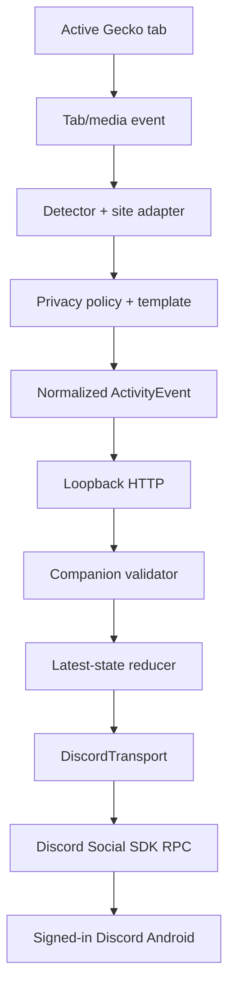
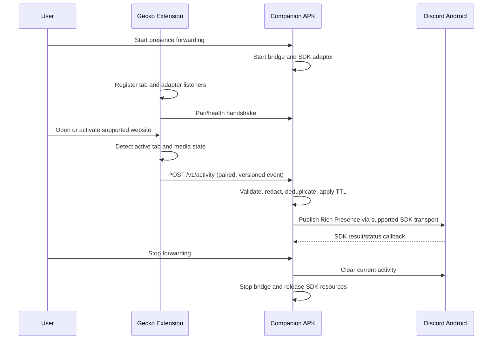

# Architecture — Gecko Presence Bridge

## 1. Components

### Gecko WebExtension

- Manifest V2 event page (`persistent: false`) for Firefox Android.
- Small TypeScript source compiled to browser JavaScript.
- Top-level listeners register synchronously so event-page wakeups can dispatch correctly.
- `tabs.onActivated`, `tabs.onUpdated`, `tabs.onRemoved`, and media/content-script messages drive state changes.
- Content scripts are registered only for known adapter domains; generic tab metadata is handled by the background script.
- Site adapters are local code, not remote scripts.

### Android Companion APK

- `MainActivity`: pairing, profile, allowed-site, template, privacy, start/stop UI.
- `PresenceService`: user-started lifecycle owner for the local bridge and Discord transport. If continuous background execution is needed, service type and policy must be selected against the target Android API and documented use case before implementation.
- `LoopbackBridge`: validates HTTP messages from the extension; binds only to `127.0.0.1`.
- `PresenceCoordinator`: latest-state-wins reducer, expiry, deduplication, profile redaction, and clear behavior.
- `DiscordTransport`: interface around the official Android SDK adapter.
- `DiscordNativeAdapter`: C++ SDK integration through JNI, only after the feasibility gate passes.

### Discord

The current proposed path is Discord Social SDK Android Rich Presence over its Android RPC transport. Discord's release notes state that SDK 1.10.18247 added unauthenticated RPC transport support on Android for publishing to the signed-in Discord Android client without OAuth. However, the SDK is positioned for game/application integrations. This project must verify non-game use eligibility and actual SDK packaging/access before adopting it.

## 2. System flow



## 3. Sequence



## 4. Browser runtime details

- Use event-page listeners. In Firefox, background service workers are not supported; Mozilla's Firefox Android guide recommends MV2 for Android compatibility.
- Persist only state required across event-page unloads. Use extension storage, not background globals, for settings and pairing state.
- Use debounced semantic updates, not one-second polling.
- Keep per-tab adapter state small; delete it on tab removal/navigation.
- Content scripts should report only relevant media metadata and state. The background worker decides whether the tab is active before forwarding.
- Avoid `unlimitedStorage`, `idle`, `scripting`, `webRequest`, and broad host access unless an accepted requirement demonstrates a need.

## 5. Local bridge API (proposed)

Base URL: `http://127.0.0.1:<ephemeral-or-configured-port>`.

| Method | Path | Purpose |
|---|---|---|
| `GET` | `/v1/health` | Returns protocol and pairing readiness, no user data |
| `POST` | `/v1/activity` | Send latest normalized activity |
| `POST` | `/v1/clear` | Clear current activity |

Required headers:

- `Content-Type: application/json`
- `Authorization: Bearer <pairing-secret>` (secret is local to the device and rotated through explicit re-pairing)
- `X-GPB-Protocol: 1`

The server must validate `Origin` against the known extension origin where supported, reject non-loopback binds, reject unknown protocol versions, enforce a small body-size limit, and apply a strict request timeout. Use a proven lightweight HTTP parser/server implementation; do not write an ad hoc HTTP parser unless dependency constraints force it and it receives dedicated tests.

### Activity event

```json
{
  "protocolVersion": 1,
  "sequence": 18,
  "eventId": "uuid",
  "kind": "activity.update",
  "source": "youtube",
  "occurredAt": 1794140000000,
  "expiresInMs": 15000,
  "activity": {
    "details": "Watching: Video title",
    "state": "YouTube",
    "startedAt": 1794139000000,
    "assetKey": "youtube"
  }
}
```

The payload intentionally excludes full URL, query, fragment, referrer, cookies, page source, and arbitrary remote image URLs. The `assetKey` must refer to an asset configured for the app's Discord application, not an arbitrary URL supplied by a website.

## 6. Presence model and Discord mapping

- Discord application identity is configured once for the project; do not promise a different registered application name for every website.
- `details` and `state` are user-template fields and can contain site/media metadata after redaction.
- `startedAt` can map to the SDK timestamp structure.
- Images should map only to asset keys configured for the Discord application.
- The SDK's Activity docs say the type that is generally relevant for the SDK is `Playing`. The enum contains other values, but those are described as provided for completeness. Use `Playing` as the safe default and make other type values an experimental test, not a shipped promise.
- Buttons/URLs are disabled in Tor profile by default and must be explicitly configured. Never forward a website-supplied URL as a button without validating scheme and user policy.

## 7. Android lifecycle

- The user must open the Companion and explicitly start forwarding.
- The Companion shows an ongoing notification while continuous forwarding is active.
- Android may restrict foreground service startup from background. Start from a visible activity or an allowed user action; do not rely on silent background startup.
- The correct foreground-service type and any Play policy implications are unresolved until the target Android API level and distribution plan are selected.
- On user Stop, clear activity, close the bridge socket, release SDK resources, and stop the service.
- On process death or OS restriction, the system may terminate the Companion. Recovery must be user-visible and should not claim continuous availability after force-stop.

## 8. Trust boundaries

| Boundary | Trusted input | Untrusted input | Required control |
|---|---|---|---|
| Website → content script | None | DOM values, title, URL, media labels | Read minimal fields; cap length; no eval/remote code |
| Content script → background | Extension message | Page-derived metadata | Validate sender tab/frame and schema |
| Extension → Companion | Paired add-on origin | HTTP message, sequence, payload | Loopback-only, pairing token, Origin, strict schema, size/TTL |
| Companion → Discord | User-approved profile/template | Adapter event | Redaction, field allowlist, current activity only |
| Build/dependencies | Lockfiles and verified official SDK | Packages, scripts, archives | Pin versions, inspect licenses, verify checksums/signatures |

## 9. Failure behavior

- Unknown website: generic presence only if enabled; otherwise clear.
- Adapter error: log a redacted diagnostic and fall back to generic presence.
- Invalid event: reject; do not crash or restart the service.
- Duplicate/out-of-order event: ignore using sequence/event ID.
- Expired activity: clear; never replay stale activity.
- Bridge disconnected: stop forwarding after the configured timeout and surface status in the notification/app.
- Discord not installed/signed in/not ready: show unavailable, retain no long history, retry only on SDK status callback or explicit user action.
- SDK transport unsupported/terms not applicable: no-go; do not silently call a private Discord REST endpoint.
