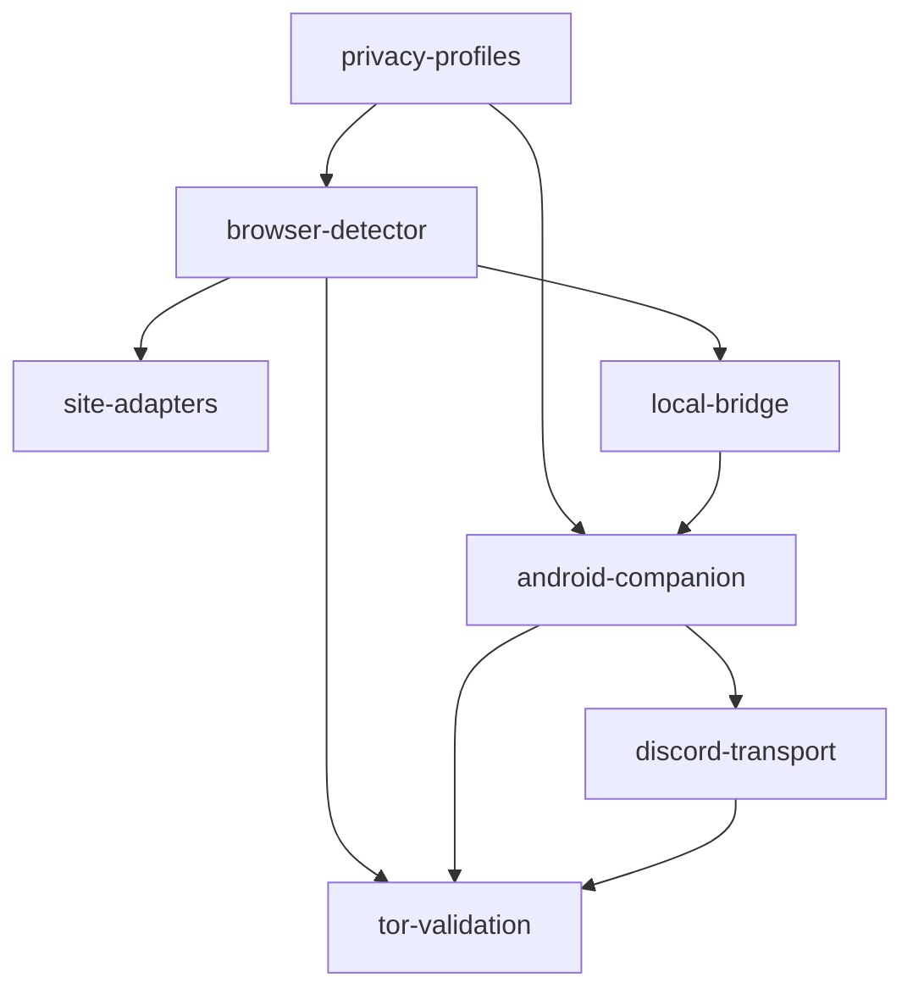

# Capability Map

## Module boundaries

| Module ID | Responsibility | Depends on | MVP output |
|---|---|---|---|
| `browser-detector` | Read active tab metadata and supported media state using Gecko WebExtension APIs | — | Normalized `ActivityEvent` |
| `site-adapters` | Enrich supported domains with title, creator/channel, episode/track, and playback metadata | `browser-detector` | Adapter output under per-site permissions |
| `local-bridge` | Pair the extension to the Companion and transfer validated event payloads over loopback | `browser-detector` | Versioned local HTTP contract |
| `android-companion` | User settings, pairing UI, lifecycle control, local bridge host, notification | `local-bridge` | APK with explicit Start/Stop control |
| `discord-transport` | Convert normalized event into Discord Social SDK activity and clear it on stop/expiry | `android-companion` | Discord SDK POC; production integration is gated |
| `privacy-profiles` | Allowlists, field redaction, template and profile selection | `browser-detector`, `android-companion` | Local-only policy configuration |
| `tor-validation` | Validate installation feasibility and privacy behavior on Tor Browser Android | All relevant modules | Experimental test report, not a support guarantee |

## Dependency direction

## Build order

1. `browser-detector`: prove the smallest Gecko-only detection path.
2. `local-bridge`: prove the extension can reach the Companion over loopback on the real Android device.
3. `discord-transport`: prove Android Social SDK RPC can publish and clear presence for this app category.
4. `site-adapters`: add one supported site at a time after core event flow is stable.
5. `privacy-profiles`: make redaction and per-site opt-in deterministic before broadening site support.
6. `tor-validation`: run last against the exact Tor Android build, without disabling Tor protections.

`discord-transport` is an external feasibility gate, not an assumed dependency we can safely implement against from memory. If the official SDK does not support this use case or cannot be obtained under its terms, the project pauses at a local activity preview rather than silently falling back to private Discord endpoints.
