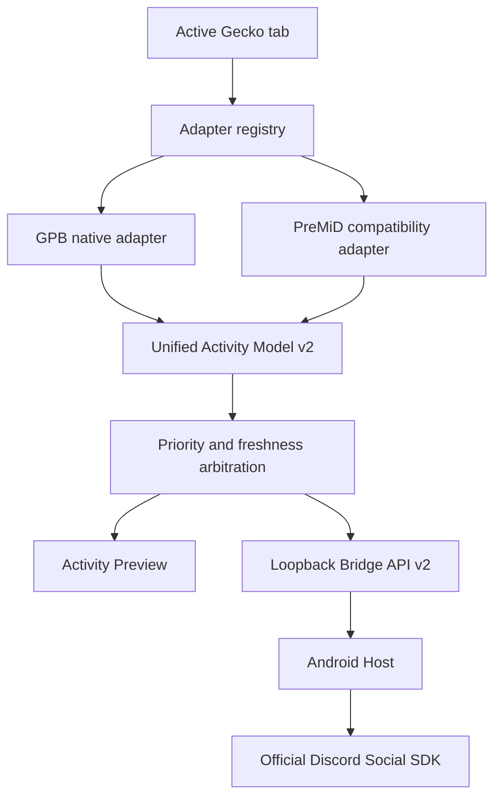

# Gecko Presence 0.5.0 — Hybrid Architecture

## Decision

0.5.0 uses a hybrid adapter strategy. GPB-native adapters own high-value integrations and platform-specific behavior. A constrained PreMiD API v1 compatibility runtime executes reviewed, pinned upstream activities when they fit the supported API profile.

## Runtime flow

## Adapter resolution

- `resolveAll(host)` returns all enabled matching adapters sorted by priority.
- Native adapters have priority over compatibility adapters.
- Compatibility candidates can act as a fallback but cannot replace a higher-priority native result.
- Sensitive hosts are rejected before adapter execution.
- A tab must be the sole active tab before it can publish presence.

## PreMiD import contract

The importer consumes only `metadata.json`, `presence.ts`, and optional `iframe.ts` from a pinned commit or a local immutable source snapshot. Every file is checked against a SHA-256 hash in `premid-imports.json`. The importer compiles the source at build time, emits a lock file and notice, and does not fetch code at runtime.

Supported compatibility surface includes `Presence` construction, `UpdateData`, `iFrameData`, `setActivity`, `clearActivity`, `getSetting`, `getStrings`, timestamp helpers, a limited `iFrame` event bridge, and static activity enums/assets. Activities that depend on unsupported page-world execution, request interception, browser privileges, dynamic modules, workers, or arbitrary network access fail import validation.

## IDLIX hybrid behavior

- `idlix-native` is the preferred adapter for current mirrors and route-aware metadata extraction.
- The historical PreMiD IDLIX activity is pinned as a compatibility adapter for its old IDLIX domain family.
- On hosts matched by both adapters, GPB injects both. The native candidate wins when confident; the lower-priority PreMiD candidate may fill a low-confidence gap.
- IDLIX metadata diagnostics record route type and extraction-source categories, never the media title or full page URL.

## Android bridge v2

- `POST /v2/activity` accepts UAM v2 fields and maps them to the Android host's compact Discord model.
- `POST /v2/clear` clears presence.
- `POST /v2/manual/clear` removes only the manual override and restores the highest-priority remaining source.
- `GET /v2/health` reports API version 2.
- Existing `/v1/*` routes remain available for older extension builds.
- The bridge remains loopback-only and requires the pairing key for writes.
- The Android host maintains one candidate per source class and arbitrates by priority: manual override (100), Android foreground app (95), confident native website adapter (90), PreMiD compatibility adapter (40), generic website fallback (10). A selected Android foreground app outranks website activity; when it clears, the highest-priority remaining website candidate is restored. Among website candidates, confident native IDLIX outranks the imported PreMiD fallback.
- Browser clear removes website candidates only; app tracker clear removes Android candidates only; manual clear restores the next available source.
- The current native SDK adapter publishes the `Playing` activity type; UAM activity types are retained for previews and adapter logic but are not all mapped to native Discord activity types yet.

## Diagnostics and user surfaces

- Activity Preview: separate live card for name, details, state, artwork, source and transport state.
- Developer Lab: adapter match, frame/runtime events, bridge state, redacted report export.
- Custom Presence Studio: manual override, local saved presets, and explicit disable/restore behavior.

## Security boundaries

- No Discord user token is read or stored.
- Imported activity code is compiled locally from a pinned snapshot and statically scanned.
- Imported activity source cannot access arbitrary browser extension APIs, cookies, persistent page storage, dynamic evaluation, direct network transports, workers, or unsupported page-world APIs.
- The bridge only listens on loopback; all write requests require a pairing key.
- Media title sharing remains subject to the Android host's final setting.
