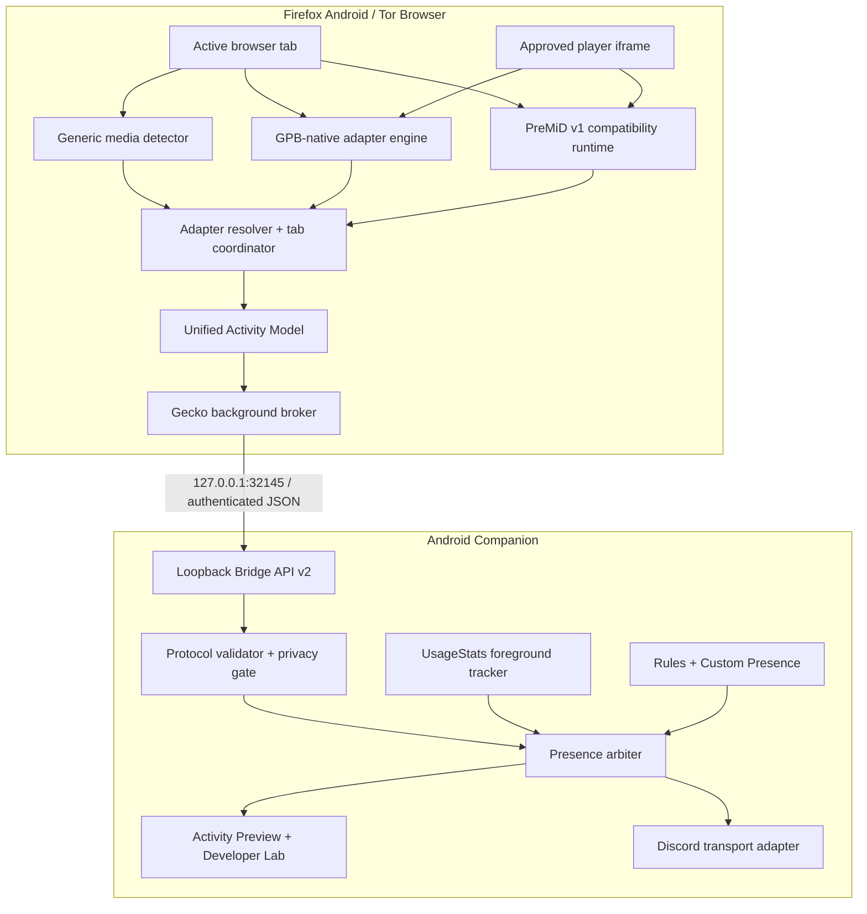

# Gecko Presence 0.5.0 — Architecture, PRD & Delivery Plan

**Document status:** Architecture baseline approved for implementation planning  
**Product release:** 0.5.0  
**Architecture decision:** Hybrid PreMiD compatibility runtime + GPB-native adapters  
**Baseline source:** Gecko Presence Suite 0.4.1  
**Research snapshot:** 10 November 2026  
**Primary browser:** Firefox for Android (Gecko)  
**Experimental browser:** Tor Browser for Android  

---

## 1. Executive decision

Gecko Presence 0.5.0 will use a **hybrid adapter architecture**.

1. **PreMiD Compatibility Runtime (PCR):** run compatible PreMiD API v1 activities through a GPB-owned compatibility facade. Upstream activity code is imported, reviewed, pinned to an immutable commit, compiled into the extension during the build, and never downloaded or evaluated at runtime.
2. **GPB-native adapters:** implement sites directly where the PreMiD activity is incompatible, incomplete, too permission-heavy, or where the site's current structure requires deeper control. Native adapters use GPB's own typed activity contract.
3. **Generic detector:** remains the fallback when no site adapter can confidently identify the page or media state.

The runtime does not embed or depend on the PreMiD desktop companion, PreMiD browser extension, or an undocumented PreMiD runtime package. The Activities repository contains activity source and API type declarations; the PreMiD extension supplies the runtime behavior. GPB must implement the subset of that runtime contract that it explicitly supports.

**IDLIX will be the first hybrid reference adapter.** Its historical PreMiD source will be preserved as an upstream reference/import fixture, while a GPB-native IDLIX adapter will own current domain matching, route handling, series/episode metadata, and player-frame coordination. The native implementation will fix gaps without pretending the archived PreMiD activity is currently maintained upstream.

### 1.1 What Hybrid means in practice

| Situation | Execution path | Reason |
|---|---|---|
| Activity uses supported PreMiD v1 APIs and permissions | PreMiD compatibility runtime | Maximize reuse of reviewed upstream activity logic |
| Activity depends on unsupported APIs, unusual iframe behavior, or custom page integration | GPB-native adapter | Avoid fragile emulation or excessive browser privileges |
| No suitable adapter, or adapter produces no confident result | Generic media/site detector | Graceful fallback |
| User has an active Custom Presence override | Custom Presence resolver | Explicit manual override takes priority |

Hybrid is **not** a remote plug-in loader. It is a build-time source-import and compilation strategy with a small runtime API shim.

---

## 2. Project baseline and constraints

The 0.4.1 source already separates the Android Host from the Gecko WebExtension:

- `GeckoPresenceHost`: Android app, Usage Access tracker, local bridge, source/presence policy, optional Discord transport.
- `GeckoPresenceBridge`: TypeScript extension source, generated Gecko extension, content-side media detection, options/permissions, and tests.
- One APK bundles the extension export for installation into Firefox/Tor; the XPI is still installed by the user in the target browser.
- Android foreground tracking uses `UsageStatsManager` and the explicit app allowlist. It does not read arbitrary application screens or media titles.
- The browser bridge binds to `127.0.0.1:32145`; the extension background context owns the pairing secret and posts to the local host.
- Browser forwarding is active-tab-only. The host does not receive a browsing history.
- Existing bridge endpoints are `/v1/health`, `/v1/activity`, and `/v1/clear`.
- Existing `SDK_MISSING`/preview behavior is intentional when the official Discord SDK AAR and application configuration are absent. Local preview is not proof that Discord received an activity.

0.5.0 must preserve these constraints. The new adapter system must not introduce Accessibility Service scraping, Notification Listener scraping, broad `<all_urls>` injection, Discord user-token extraction, arbitrary shell execution, or runtime downloads of executable adapter code.

### 2.1 Explicit platform truth

- Android Usage Access can identify the foreground package; it cannot infer a movie title or song from arbitrary apps.
- Website metadata is collected inside the browser extension, because Android cannot inspect Firefox/Tor tabs through ordinary app APIs.
- Firefox Android is the primary target. Tor Browser remains experimental until the exact installed browser build passes the compatibility matrix.
- An installed XPI is required for website detection. Bundling the XPI inside the APK does not install it into Firefox automatically.
- A successful extension-to-host connection and an accurate Activity Preview do not establish that the Discord publishing transport is ready.

---

## 3. IDLIX archaeology — confirmed findings

The earlier search missed IDLIX because it is no longer in the current `main` tree of `PreMiD/Activities`. Its history is recoverable.

### 3.1 Historical timeline

| Date | Evidence | Finding |
|---|---|---|
| 24 Aug 2021 | [Issue #4295](https://github.com/PreMiD/Activities/issues/4295) | Original IDLIX presence request, initially described as `idlix.cc` with a domain that kept changing |
| 22 Dec 2022 | [PR #7072](https://github.com/PreMiD/Activities/pull/7072) | IDLIX activity added; initial design had `metadata.json`, `presence.ts`, and `iframe.ts` |
| 29 Apr 2024 | [Commit 6da804f](https://github.com/PreMiD/Activities/commit/6da804f2777092a53dbc891ccdf727f0dad2243c) | Presence rewritten and issues fixed |
| 16 Oct 2024 | [Commit 960f805](https://github.com/PreMiD/Activities/commit/960f805054fde7f5701f89d2e054cbabd1af5cb3) | Domain metadata updated |
| 13 Mar 2025 | [Commit 5f17e45](https://github.com/PreMiD/Activities/commit/5f17e457e567720b90432eace490074599d65008) | Matching regex simplified |
| 3 Apr 2025 | [Commit 6b926be](https://github.com/PreMiD/Activities/commit/6b926be512e9ae2b682c4f5e79a1f682c70ea301) | Strings issue fixed |
| 7 Dec 2025 | [Commit f75faa1 / PR #10175](https://github.com/PreMiD/Activities/commit/f75faa1585cca7d81b4b85694829a2dfbb6ab00a) | Domain matcher fixed for public/private IP and host matching |
| 9 Jul 2026 | [Issue #10980](https://github.com/PreMiD/Activities/issues/10980) | Exact report for `z2.idlixku.com/series`: movies worked but series activity did not |
| 15 Sep 2026 | Issue #10980 closed | Closed as inactive/not planned after stale automation; no fix is recorded in the issue |
| 28–29 Sep 2026 | [PR #11251](https://github.com/PreMiD/Activities/pull/11251) and [removal commit e4c0de9](https://github.com/PreMiD/Activities/commit/e4c0de9c04a3d310877343bdc05b04bdd7b42603) | IDLIX removed from the current activity tree because its configured URL `vip2.idlixvip.asia` failed A/AAAA DNS checks after three attempts |

The removal was a DNS-validation cleanup, not evidence that the activity never existed. It also does not prove that every IDLIX mirror is offline. The activity's configured canonical URL failed the repository's check at that point.

### 3.2 The exact old implementation pattern

The archived PreMiD activity used three files:

- `metadata.json`: service identity, canonical URL, regular-expression matcher, iframe matcher, settings, logo and thumbnail.
- `presence.ts`: reads the top-level page, maps routes, extracts the title/poster, and builds presence data.
- `iframe.ts`: observes a `video` element in a matching player frame and sends `currentTime`, `duration`, `paused`, and `isVideo` to the main presence script. It does not extract the movie/series title.

The last source before removal is recoverable from the repository history. A useful source pin for the 2025 matching fix is commit `f75faa1585cca7d81b4b85694829a2dfbb6ab00a`. The removal commit itself records the exact deleted files and the then-current metadata version.

### 3.3 Historical title and route logic

The historical presence code attempted the following title sources, in priority order:

1. `.pag_episodes` → second anchor's `title` attribute
2. `.epih1` text
3. `.data` → first child text
4. `meta[property="og:title"]`, with the IDLIX suffix removed
5. `<title>`, with the IDLIX suffix removed
6. Fallback text `Unknown`

It attempted artwork from `.poster img`, then `.owl-wrapper img`, then the activity logo. It used `.epih3` for secondary episode/series context. The iframe helper only passed playback timing/state.

The historical main route switch explicitly included `movie`, `episode`, `episodes`, and `tvseries`, but did not include a `series` route. This is a strong candidate for the July 2026 series report, but it is not proven to be the only cause. A route, selector, DOM, or iframe-origin change could also have contributed.

### 3.4 Why this matches the current GPB symptom

Current device report: GPB detects the site and player state (`IDLix`, `Paused`, `z2.idlixku.com`) but the media title/episode context is missing.

That means the basic site/frame detection path is at least partially working. The remaining failure is likely in one or more of these layers:

- top-level page title selector no longer matches the current mirror;
- series route is not handled or is handled as a generic route;
- player frame is detected but only sends media timing, while title data is located in the parent page;
- the active player uses a new iframe origin that is not covered by the old `jenius|filmdewasa` matcher or the user's current per-domain permission;
- generic-media fallback wins before the site adapter finishes producing richer data.

0.5.0 must expose enough diagnostics to distinguish these cases. It must not silently present a host name as if it were a verified media title.

### 3.5 IDLIX 0.5 acceptance behavior

For the current test host `z2.idlixku.com`, the adapter must distinguish:

- homepage/browsing;
- catalogue/search page;
- movie detail page;
- movie playback;
- series detail/catalogue page;
- episode detail page;
- episode playback;
- paused playback;
- ended or unavailable playback;
- third-party player iframe found/not found.

A series or episode must not be labelled as a movie merely because the generic video detector sees a `<video>` element. Missing values must be omitted or replaced with a clearly generic state; they must not be fabricated.

---

## 4. Goals, non-goals and success criteria

### 4.1 Product goals

1. Import a curated subset of PreMiD API v1 activities without rewriting each activity from scratch.
2. Keep a GPB-native adapter path for difficult sites and for features that do not fit the compatibility API.
3. Preserve low resource usage on Android and mobile Gecko browsers.
4. Provide a reliable unified presence model regardless of whether an event came from PreMiD compatibility, a native adapter, generic media detection, or Android app tracking.
5. Make activity selection deterministic when multiple tabs or Android apps are active.
6. Provide a Discord-like Activity Preview separate from the Developer Lab.
7. Add a Developer Lab with adapter/frame/API diagnostics and privacy-safe export.
8. Preserve explicit per-site permissions and the existing conservative privacy policy.
9. Make builds reproducible and adapter source provenance auditable.

### 4.2 Non-goals

- Full PreMiD runtime or desktop companion emulation.
- Full support for every activity in the PreMiD repository.
- Dynamic runtime installation, self-updating scripts, or remote code execution.
- Running arbitrary third-party JavaScript supplied by a URL.
- Emulating every PreMiD API method regardless of security/performance cost.
- Reading site cookies, credentials, chat messages, or account information.
- Circumventing DRM, paywalls, authentication, or browser/Tor restrictions.
- Automatically discovering all cross-origin iframe permissions.
- Guaranteed Discord publishing when the official supported transport is absent.
- Treating Tor Browser as a fully supported stable target before device validation.

### 4.3 Release success criteria

0.5.0 can be called feature-complete only when:

- imported PreMiD v1 activities are pinned, licensed, compiled, and tested;
- the runtime passes the API contract tests for every API it advertises;
- a native adapter can override or replace an imported adapter without causing duplicate presence updates;
- IDLIX movie and series/episode flows have test fixtures and pass the real-device test matrix;
- the Developer Lab can explain why an adapter matched, what it observed, and why fields were omitted;
- Activity Preview accurately renders the normalized activity payload;
- bridge v2 is validated on both extension and host, with v1 compatibility retained;
- Firefox Android passes the signed-XPI installation, permission, active-tab and loopback tests;
- security, privacy, and performance gates pass;
- the Discord transport status is labelled truthfully as ready, unavailable, or preview-only.

---

## 5. Target system architecture



### 5.1 Extension components

**A. Tab Coordinator**
- Tracks only the foreground/active tab as an eligible publisher.
- Stops or suppresses background-tab adapters from replacing the current status.
- Clears stale activity on tab close, browser navigation, active-tab change, permission revocation, or adapter disposal.
- Uses a per-tab generation ID and monotonically increasing sequence number to reject late results.

**B. Adapter Resolver**
- Matches the top-level hostname and path against the installed registry.
- Evaluates adapter priority, user enable/disable state, required permission grants, and supported capabilities.
- Starts one primary site adapter per active tab.
- Allows a frame helper to contribute media state to its parent adapter, but not to publish an independent competing activity.
- Falls back to generic detection when a primary adapter has no confident result or fails.

**C. Generic Detector**
- Retains the 0.4.1 event-driven media detector.
- Observes supported `play`, `pause`, `ended`, metadata, and title mutations.
- Does not run a global one-second polling timer.
- Does not override a site adapter that has emitted a more specific, fresh result.

**D. GPB-native Adapter Engine**
- Loads statically bundled native adapters from the registry.
- Gives adapters a constrained context: sanitized URL, document access, approved frames, media events, settings, and read-only diagnostics.
- Requires each adapter to declare fields collected and domains/frames required.
- Has explicit lifecycle hooks (`start`, `onNavigation`, `onMedia`, `onFrameMessage`, `dispose`).

**E. PreMiD Compatibility Runtime (PCR)**
- Provides a GPB-owned implementation of the supported PreMiD API v1 surface.
- Compiles imported activity code before release and binds the runtime APIs at build time.
- Creates one isolated adapter instance per active tab and activity.
- Converts `PresenceData` into GPB's Unified Activity Model.
- Implements frame-to-parent messages through the extension broker, not unrestricted page `postMessage` traffic.

**F. Gecko Background Broker**
- Owns browser tab arbitration and the bridge pairing key.
- Receives content-script updates, applies sequence/TTL rules, and forwards only the current normalized activity.
- Sends the bridge request to `127.0.0.1:32145` from the extension background context.
- Never exposes the pairing key to the webpage or an imported activity script.

### 5.2 Android Host components

**A. Loopback Bridge API**
- Keep the current loopback-only bind address: `127.0.0.1:32145`.
- Retain `/v1/health`, `/v1/activity`, and `/v1/clear` for 0.4.1 compatibility.
- Add `/v2/health`, `/v2/activity`, `/v2/clear`, and `/v2/diagnostics` for 0.5.0.
- Require the pairing key for write routes.
- Enforce request-size limits, content-type checks, schema validation, origin checks, rate limits, freshness, and strict field allowlists.
- Do not accept remote URLs for arbitrary fetch, shell commands, file paths, package names, or OAuth/user tokens.

**B. Presence Validator and Privacy Gate**
- Normalize text lengths and timestamps.
- Reject malformed image/button values.
- Apply the host-side Share Page/Media Titles setting as the final authority.
- Reapply privacy deny rules to every event rather than trusting only extension-side filtering.
- Drop URL paths, queries, fragments, credentials, and referrers from the payload by default.

**C. Presence Arbiter**
Priority order:

1. Explicit user Custom Presence override.
2. Eligible browser activity from the active tab.
3. Eligible explicitly selected Android foreground app.
4. Idle/cleared state.

The resolver must not merge unrelated sources. It publishes one complete latest activity, not a mix of fields from different tabs/apps. A source change resets fields that are not present in the new source.

**D. Discord Transport**
- Remains behind a transport interface and capability report.
- Maps only supported fields to the currently configured official SDK integration.
- Does not invent support for activity types, external image URLs, buttons, party data, or platform flags.
- Reports `SDK_MISSING`, `SDK_NOT_READY`, `SDK_READY`, `SDK_ERROR`, or `PREVIEW_ONLY` accurately.
- Never uses Discord user tokens, private endpoints, or undocumented RPC as a fallback.

**E. Preview and Diagnostics**
- Activity Preview renders the normalized activity independently of whether Discord publishing is ready.
- Developer Lab shows matching, capability, permission, iframe, bridge and runtime diagnostics.
- Logs are capped, local, opt-in for export, and scrubbed by default.

---

## 6. Unified Activity Model (UAM)

All sources must normalize into one model before reaching the Android bridge. PreMiD-specific types and method names must not leak into the host contract.

### 6.1 Canonical model

```ts
export type ActivitySourceKind =
  | 'premid-compat'
  | 'gpb-native'
  | 'generic-media'
  | 'android-app'
  | 'custom-presence'

export type MediaState =
  | 'playing'
  | 'paused'
  | 'buffering'
  | 'ended'
  | 'browsing'
  | 'unknown'

export interface ActivityImage {
  url?: string
  assetKey?: string
  tooltip?: string
}

export interface ActivityButton {
  label: string
  url: string
}

export interface UnifiedActivity {
  schemaVersion: 2
  eventId: string
  sequence: number
  occurredAt: number
  expiresAt: number
  source: {
    kind: ActivitySourceKind
    adapterId: string
    adapterVersion: string
    displayName: string
    host?: string
    instanceId: string
  }
  activity: {
    name?: string
    type?: 'playing' | 'streaming' | 'listening' | 'watching' | 'competing'
    details?: string
    state?: string
    statusDisplay?: 'name' | 'state' | 'details'
    startedAt?: number
    endsAt?: number
    largeImage?: ActivityImage
    smallImage?: ActivityImage
    buttons?: ActivityButton[]
  }
  media?: {
    state: MediaState
    currentTime?: number
    duration?: number
    playbackRate?: number
    mediaKind?: 'audio' | 'video' | 'unknown'
  }
  privacy: {
    titlePresent: boolean
    artworkPresent: boolean
    pathIncluded: false
  }
}
```

`host` is a hostname only. The bridge must not receive a full URL unless a future explicit diagnostics workflow adds a locally visible, separately consented path field. The browser extension may inspect pathname locally for route matching but does not forward it by default.

### 6.2 Normalization rules

- `details` and `state` are plain text, not HTML; DOM nodes are converted to bounded `textContent`.
- Text is trimmed, normalized, and capped before bridging.
- `startTimestamp`/`endTimestamp` from PreMiD are converted into epoch milliseconds or seconds consistently at the model boundary. The bridge schema chooses one canonical unit and rejects mixed units; use epoch milliseconds in UAM, then adapt in the publisher.
- Images must be HTTPS URLs on an adapter-declared host, or an approved registered asset key. `blob:`, `file:`, `javascript:`, and unbounded `data:` URLs are rejected.
- Buttons are limited to two, use bounded labels, and must point to HTTPS URLs within an approved target policy.
- Unknown PreMiD fields are ignored with a diagnostic warning; they are not copied blindly into the host payload.
- A missing field is absent, not an empty string that can overwrite another source's valid value.

### 6.3 Arbitration and freshness

- Only one browser tab owns the browser source slot.
- Each activity instance has a random `instanceId` and increasing `sequence`.
- Default activity TTL: 15 seconds; media adapters may renew it from media events or a throttled update tick.
- Stale or out-of-order events are ignored.
- `clear` is a higher-priority terminal event and immediately invalidates queued updates from the same instance.
- Duplicate semantic payloads are not forwarded repeatedly.
- Source change creates a new complete payload; fields from the previous site/app are not retained.

---

## 7. PreMiD Compatibility API v1

PreMiD activity metadata currently declares `apiVersion: 1`; its documentation describes API v1 as the stable activity API and v2 as a newer API under development. 0.5.0 will target **API v1 only**. API v2 imports are rejected or held for a later compatibility profile until its contract is stable and separately tested.

### 7.1 Supported API surface

| PreMiD surface | 0.5.0 support | Notes |
|---|---|---|
| `new Presence({ clientId, injectOnComplete })` | Supported | Creates a tab-scoped compatibility instance; `clientId` is metadata only and never grants Discord account access |
| `presence.on('UpdateData', cb)` | Supported | PCR scheduler dispatches the event while the tab is active and permitted |
| `presence.on('iFrameData', cb)` | Supported | Receives data from a matching, approved frame instance |
| `presence.setActivity(data)` | Supported | Normalizes allowed `PresenceData` fields into UAM |
| `presence.clearActivity()` | Supported | Clears only the calling activity instance |
| `presence.setActivity()` with no data | Compatibility warning | Maps to clear for safety; emits a warning because modern PreMiD documents `clearActivity()` as the intended clearing method |
| `presence.getSetting(id)` | Supported | Reads GPB-local settings generated from imported metadata; values never leave device unless used in an activity payload |
| `presence.getStrings(map)` | Supported | Resolves `general.*` and packaged service-local strings; fallback is English/key text |
| `presence.getTimestamps(current, duration)` | Supported | Helper conversion only; output is normalized at the UAM boundary |
| `getTimestamps()` / `getTimestampsFromMedia()` | Supported | Imported from the local compatibility module; no remote package fetch |
| `ActivityType`, `StatusDisplayType`, `Assets` | Supported subset | Enumerations are translated to canonical GPB values; unknown enum values warn and are omitted |
| `presence.getExtensionVersion()` | Supported | Returns GPB extension version with a GPB compatibility marker |
| `presence.info/success/error()` | Supported | Local Developer Lab logs only; no external telemetry |
| `new iFrame()` | Supported | Creates a frame-side scoped instance |
| `iframe.on('UpdateData', cb)` | Supported | Dispatch only in explicitly matched and permitted frames |
| `iframe.send(data)` | Supported | Structured-clone payload, bounded size, strict frame-origin binding |
| `iframe.getUrl()` | Supported with redaction | Returns the frame URL to the activity code for local logic; it is not forwarded to Android logs or presence by default |
| `presence.getPageVariable()` / deprecated `getPageletiable()` | Partial | Safe read-only path access only; bounded serializable primitives/objects; no unrestricted page-object traversal |
| `presence.hideSetting()` / `showSetting()` | Partial | Updates visibility in the local imported-activity settings UI |
| `presence.createSlideshow()` | Partial | Only basic slides and a bounded scheduler; no unbounded timers or unsupported fields |
| `presence.getLogs()` | Partial | Reads only the activity's capped local diagnostic buffer; never captures unrelated site console logs by default |
| `supports()` | Supported | Reports the PCR capability set, not the upstream PreMiD browser extension's capability set |
| `presence.execInPage(fn, ...args)` | Not supported in 0.5.0 | Arbitrary function serialization/injection is excluded. Importer flags this as incompatible |
| `presence.execInPage(spec)` | Future/experimental | Declarative read-only `get` may be considered after a separate CSP and page-world security review; `call` is not included in 0.5.0 |
| `presence.onRequest()` | Not supported in 0.5.0 | Request interception increases data collection and permissions; requires a separate privacy review |
| Arbitrary `fetch`, WebSocket, XHR, EventSource | Restricted | Network destinations are constrained by the adapter manifest and a runtime allowlist |

### 7.2 Runtime API facade

The build includes a local module alias for `premid`. The imported code is compiled against that alias, not the upstream PreMiD runtime. The compatibility module exports the tested helper functions and the TypeScript declarations needed for activity compilation.

The global `Presence`, `iFrame`, and `PresenceData` symbols are provided by the compatibility bootstrap for older activity scripts that rely on globals. Imported modules that use `import { ActivityType, Assets, getTimestamps } from 'premid'` resolve to the local facade.

Example activity source can remain close to the original API:

```ts
const presence = new Presence({ clientId: 'example-client-id' })

presence.on('UpdateData', async () => {
  const data: PresenceData = {
    type: ActivityType.Watching,
    details: 'Watching a film',
    state: 'Example title',
  }

  await presence.setActivity(data)
})
```

This API is only a compatibility façade. `clientId` is not used to log in as a Discord user, and it is not a replacement for the Host's approved Discord transport.

### 7.3 Event scheduling

- One update scheduler per active compatibility instance.
- Update cadence is adaptive and measured; initial cap is 5 seconds for active media and 10 seconds for browsing updates, with event-driven media changes triggering immediate coalesced refreshes.
- A callback overrun does not queue multiple concurrent invocations. The next tick is skipped until the current callback completes.
- Hidden/background tabs do not continue expensive adapter work. The current active tab is re-evaluated on tab activation.
- `iframe.ts` receives `UpdateData` only when its parent adapter is active, the frame origin is approved, and the frame is not a known trailer/unrelated frame.
- Every listener, observer, timer, media event handler and frame channel is disposed on navigation, permission revoke, adapter switch, or tab close.

### 7.4 Capability reporting

Each adapter instance receives a `CompatibilityReport`:

```ts
interface CompatibilityReport {
  apiVersion: 1
  runtimeVersion: string
  supported: string[]
  partial: string[]
  unsupported: string[]
  missingPermissions: string[]
  warnings: string[]
}
```

An imported activity must not silently rely on unsupported methods. The importer scans static references, and Developer Lab reports runtime calls that are not implemented.

---

## 8. Adapter contract and registry

### 8.1 Native adapter interface

```ts
export interface NativeAdapterManifest {
  id: string
  version: string
  displayName: string
  hosts: string[]
  pathPatterns?: string[]
  frameHosts?: string[]
  priority: number
  permissions: ('dom.read' | 'media.read' | 'frames.read' | 'page-variable.read')[]
  capabilities: string[]
  fieldsCollected: string[]
  privacyProfile: 'standard' | 'private-compatible'
}

export interface AdapterContext {
  document: Document
  location: { hostname: string; pathname: string; origin: string }
  settings: Record<string, string | number | boolean>
  media: MediaSnapshot | null
  frames: ReadonlyArray<FrameSnapshot>
  emit(activity: AdapterActivity): void
  diagnose(event: DiagnosticEvent): void
  requestFrameAccess(host: string): Promise<boolean>
}

export interface NativeAdapter {
  manifest: NativeAdapterManifest
  start(context: AdapterContext): void | Promise<void>
  onNavigation?(context: AdapterContext): void | Promise<void>
  onMedia?(media: MediaSnapshot, context: AdapterContext): void | Promise<void>
  onFrameMessage?(frame: FrameSnapshot, payload: unknown, context: AdapterContext): void | Promise<void>
  dispose(): void
}
```

Adapter context does not expose the bridge pairing key, Android file system, shell, arbitrary browser tabs, Discord tokens, or unrestricted network access.

### 8.2 Adapter manifest

Every adapter is packaged with a generated manifest. Native and imported adapters share the registry, but the `runtime` section identifies the execution path.

```json
{
  "schemaVersion": 1,
  "id": "gpb.idlix",
  "displayName": "IDLIX",
  "version": "0.5.0-native.1",
  "runtime": {
    "kind": "native",
    "minGpbVersion": "0.5.0"
  },
  "source": {
    "kind": "gpb-native",
    "repository": "local",
    "commit": null,
    "contentSha256": "generated-at-build"
  },
  "matching": {
    "hosts": ["z2.idlixku.com"],
    "pathPatterns": ["/movie/*", "/series/*", "/episode/*", "/episodes/*"],
    "frameHosts": []
  },
  "permissions": ["dom.read", "media.read", "frames.read"],
  "fieldsCollected": ["service", "mediaTitle", "episodeContext", "playbackState", "playbackTime", "poster"],
  "privacy": {
    "shareTitleRequiresUserSetting": true,
    "storeHistory": false,
    "forwardFullUrl": false
  },
  "entrypoints": {
    "main": "adapter.js",
    "frames": ["player-frame.js"]
  }
}
```

The current `z2.idlixku.com` host is included as the explicit test host because it appears in the 2026 upstream issue and the current device report. Historical domains and IPs are not automatically granted. New mirror domains require review and an explicit browser permission grant.

### 8.3 Registry behavior

- Registry is a static generated index bundled inside the XPI.
- An adapter can be enabled/disabled independently from its installation.
- User permission state is separate from the adapter manifest; the manifest declares requirements, but the user grants actual host access.
- The resolver records why an adapter matched, declined, or lost priority.
- Version conflicts and invalid bundles fail closed; the generic detector remains available.
- Exactly one adapter instance is the primary publisher for a tab. A frame helper can only contribute to its parent.

---

## 9. PreMiD adapter import system

### 9.1 Source pinning

A source lock file records every upstream activity import. Example:

```json
{
  "schemaVersion": 1,
  "imports": [
    {
      "id": "premid.idlix.reference",
      "repository": "PreMiD/Activities",
      "commit": "f75faa1585cca7d81b4b85694829a2dfbb6ab00a",
      "path": "websites/I/IDLIX",
      "apiVersion": 1,
      "license": "MPL-2.0",
      "files": ["metadata.json", "presence.ts", "iframe.ts"],
      "sourceSha256": "generated-by-importer",
      "enabled": false,
      "notes": "Historical upstream reference; IDLIX currently uses a GPB-native adapter"
    }
  ]
}
```

The example pin is a historical reproducibility anchor. Before shipping an imported adapter, the importer must compute exact file hashes from the selected commit, include the upstream license/notice material, and mark any modifications. Do not trust a moving `main` branch.

### 9.2 Import pipeline

1. **Resolve source:** fetch repository, immutable commit and exact activity directory. No branch-head imports in release builds.
2. **File allowlist:** accept `metadata.json`, `presence.ts`, `iframe.ts`, explicitly imported local modules, activity-local translations, and required assets. Reject hidden files, package scripts, arbitrary binaries and unrelated repository files.
3. **License audit:** resolve repository license and file notices; generate `THIRD_PARTY_NOTICES.md`; fail if licensing is missing or incompatible with distribution policy.
4. **Metadata validation:** parse `apiVersion`, `url`, `regExp`, `iframe`, `iFrameRegExp`, settings, tags, category and asset references. Require `apiVersion: 1` in 0.5.0.
5. **Host normalization:** convert metadata domains/regexes into an explicit, reviewed match policy. Broad regexes must be reviewed for false positives; no blanket `.*` or arbitrary public-IP matching.
6. **Capability scan:** detect API methods, imports, browser globals, network APIs, dynamic imports, `eval`, `new Function`, timers, storage, and iframe assumptions. Generate a compatibility report.
7. **Dependency resolution:** allow only local modules and a reviewed dependency allowlist. No dependency lifecycle scripts. Package-lock and exact versions are pinned.
8. **Static compilation:** compile using the local PreMiD compatibility facade and a pinned TypeScript/esbuild toolchain. Bundle main and frame entrypoints into static JS.
9. **Manifest generation:** emit adapter manifest, required permission set, field-collection policy, source commit/hash, runtime range and attribution data.
10. **Fixture tests:** execute under mocks for DOM, media, frame events, settings and API callbacks. Any unsupported API use must be a build warning or hard failure according to policy.
11. **Security review:** verify that imports cannot access the bridge secret, host filesystem, arbitrary browser tabs or unapproved network destinations.
12. **Package:** embed compiled files and source notices inside the XPI/APK source bundle. Do not fetch source or executable code on the user's device.

### 9.3 CLI and build integration

Proposed tooling:

```text
GeckoPresenceBridge/
  scripts/
    import-premid.mjs
    validate-adapter.mjs
    build-adapters.mjs
    generate-adapter-registry.mjs
  adapter-sources/
    premid-sources.lock.json
    premid/
      idlix-reference/
  src/
    adapters/
      native/
      premid-compat/
      generic/
  generated/
    adapters/
    adapter-registry.json
    third-party-notices/
```

The importer runs in GitHub Actions and locally under Node 22. It should support a dry-run report so a developer can inspect file paths, metadata, API usage, requested permissions, license, and hash before admitting an activity.

### 9.4 Runtime code policy

- No remote script URL is loaded into the extension.
- No arbitrary import by URL.
- No `eval`, `new Function`, or dynamic module loader in imported activity code.
- `fetch` is restricted to manifest-approved HTTPS origins; unknown origins fail with a diagnostic.
- WebSocket, EventSource, XHR, service workers and arbitrary worker creation are denied unless a later, separately reviewed adapter capability allows them.
- Timers are wrapped with quotas and disposed with adapter lifecycle.
- Imported code cannot read or write browser storage except through GPB settings APIs.
- The pairing key, Android package data and Discord transport are never visible to an activity instance.

### 9.5 Import policy: curate, do not bulk-copy

The PreMiD repository contains a large activity library, but importing all activities would increase XPI size, permissions, test burden and attack surface. 0.5.0 imports only activities that:

- have a clear user demand;
- use APIs that PCR supports;
- have working and sufficiently narrow host matching;
- have tested page and iframe behavior;
- have acceptable licensing and source provenance;
- pass the performance/privacy gates.

Start with the IDLIX historical reference and one or two low-complexity activities to validate the importer. Add further activities after the import pipeline is stable.

---

## 10. IDLIX hybrid adapter design

### 10.1 Implementation strategy

- Keep the archived PreMiD IDLIX source as a pinned reference/import fixture, not as the sole production implementation.
- Implement `gpb.idlix` as a native adapter.
- Use the PCR to prove that a historically supported v1 activity can be compiled and run, but give the GPB-native adapter higher priority for IDLIX.
- Keep the generic media detector as a fallback only.

### 10.2 Domain policy

- First supported host: `z2.idlixku.com` (the host already observed in the user's device test and cited in upstream issue #10980).
- Do not import the old broad IDLIX/IP regex as an unrestricted browser host permission.
- Historical hostnames such as `vip2.idlixvip.asia`, `tv.idlixvip.asia`, old IP addresses, `jeniusplay.com`, or `filmdewasa` are reference evidence only. Add them only after the current page's redirect/frame chain is observed and permission is explicitly granted.
- Matching a hostname does not automatically grant access to its player iframe.

### 10.3 Route model

Normalize routes into a small internal enum:

```ts
type IdlixPageKind =
  | 'home'
  | 'search'
  | 'catalogue'
  | 'movie-detail'
  | 'movie-playback'
  | 'series-detail'
  | 'episode-detail'
  | 'episode-playback'
  | 'unknown'
```

The adapter must explicitly handle `/series` and known series/episode routes. Route parsing must be fixture-tested. The exact route table must be based on observed DOM/URL fixtures from the current mirror, not inferred only from the old activity.

### 10.4 Metadata extraction order

For a title, use a tested confidence ladder:

1. Current visible page's canonical media heading or player overlay title.
2. Structured metadata (`og:title`, JSON-LD `Movie`/`TVEpisode`/`TVSeries`) if it identifies the page's media entity.
3. Known IDLIX route-specific elements (historical selectors retained as candidates).
4. Document title after removing known site suffixes.
5. Generic host-level label only as a browsing fallback.

For series/episode context, keep separate fields for:

- `seriesTitle`
- `episodeTitle`
- `seasonNumber`
- `episodeNumber`
- `episodeLabel`

Do not collapse all of these into one title string until the display policy chooses the final Details/State layout.

### 10.5 Player frame model

- The top-level IDLIX adapter owns the activity and extracts movie/series metadata.
- A player-frame helper reports only media state, time, duration, playback rate and a frame-local diagnostic ID.
- The main adapter merges media state with parent-page title metadata.
- Trailer, advertisement and unrelated frames are excluded.
- Frame origin is displayed in Developer Lab; frame access requires a separate, explicit host permission.
- Frame messages use structured clone, bounded size and an instance-specific channel. Do not trust `window.postMessage` data based solely on a claimed `origin` field.

### 10.6 IDLIX acceptance matrix

| Scenario | Expected normalized result |
|---|---|
| Open `/` | `IDLIX` + browsing/home context; no invented title |
| Open `/series` | catalogue/series browsing state; no stale movie data |
| Open a series detail page | series title and artwork where available |
| Open an episode page | series context plus episode label where available |
| Play a movie | movie title + `Watching` + playing/paused state + timing when duration is finite |
| Play a series episode | series/episode context + `Watching` + media state/timing |
| Pause | title remains; media state changes to paused; end timestamp is removed or recalculated according to policy |
| Switch tab | old IDLIX activity is invalidated; active tab wins |
| Frame permission denied | parent title may still appear; media state says unknown/unavailable, not falsely paused |
| Unknown mirror | adapter does not match until user grants the new host; generic detector may run |
| Title cannot be extracted | show a generic IDLIX browsing/watching status, never the domain as a media title |

---

## 11. Activity Preview and Developer Lab

These are two distinct views, not one combined diagnostics panel.

### 11.1 Activity Preview

Purpose: show the exact payload that GPB intends to publish, with a Discord-like visual layout.

Required fields:
- Activity/application name and activity type.
- Details and State rows.
- Large artwork, tooltip text and small artwork/tooltip text.
- Media state, elapsed/remaining time when supported.
- Up to two buttons (rendered as a preview only; actual buttons depend on transport support).
- Source chip: Android app, generic web, PreMiD-compatible, native adapter, or Custom Presence.
- Publisher state: Preview only, queued, published, unavailable, error.
- Timestamp of last accepted update and freshness/TTL indicator.

The Preview must display unsupported fields as unsupported rather than hiding them and implying they were published. The UI must clearly separate **requested payload** from **transport-confirmed payload**.

### 11.2 Developer Lab

Purpose: help diagnose adapter behavior without requiring DevTools on the Android browser.

Required panels:

1. **Runtime overview:** extension version, PCR version, active tab adapter, tab instance ID, host bridge state, SDK state.
2. **Match inspector:** current hostname/path locally, candidate adapters, regex/route match outcome, priority, reasons for accept/reject. Full path is local-only and redacted from default exports.
3. **Frame inspector:** detected frame hostnames, frame IDs, origin permission state, whether `iframe.ts`/native frame helper started, last message time, message schema errors.
4. **API compatibility:** called PreMiD methods, supported/partial/unsupported status, method warnings, callback timing and errors.
5. **Activity trace:** last 100 normalized events, coalesced duplicate count, sequence/TTL drops, field changes.
6. **DOM/selector inspector:** adapter-declared selector checks only; show matched element count and safe text preview. Do not dump full page HTML or form values.
7. **Performance:** adapter CPU/task duration estimate, update cadence, observer count, timer count, event rate and memory proxy where measurable.
8. **Export report:** JSON report plus optional text log bundle, with hostname and adapter ID, no cookies, auth headers, URL query, referrer, raw HTML, full browsing history or bridge secret.

Export must require a user gesture and show a preview of fields before copying/sharing.

---

## 12. Privacy, security and abuse controls

### 12.1 Threat model

Threats include a malicious or compromised imported activity, an unrelated webpage attempting to call the local bridge, a malicious frame spoofing messages, adapter bugs leaking page data, a stale activity replacing the active tab, and diagnostics accidentally exporting sensitive content.

### 12.2 Controls

- Bridge binds only to loopback.
- High-entropy pairing key remains in extension background storage and Android Keystore; activity contexts never receive it.
- Validate Origin where available, reject web-page origins, require pairing secret, and reject malformed/oversized payloads.
- Use monotonically increasing sequence numbers, event IDs, TTLs and per-instance identity.
- Explicit per-domain and per-frame permissions; no `<all_urls>` as a shortcut.
- Imported scripts run in an extension-controlled content context with a constrained compatibility facade.
- Network access is limited to manifest-approved HTTPS hosts and bounded response sizes.
- No page cookies, authentication tokens, form values, messages or unrelated DOM text are collected.
- Host applies privacy filtering again, even if the extension already redacted.
- No activity history is stored. Keep only the current event and short-lived diagnostics buffer.
- Diagnostic export redacts URL path by default, all query/fragment data, cookies, tokens, request/response bodies and arbitrary DOM snapshots.
- Adapter crashes must not crash the extension background broker or Android service.
- If the site adapter fails, fall back to generic mode and record the failure locally.

### 12.3 Sensitive-source policy

Keep the existing Android package denylist and browser site denylist. Imported activity metadata cannot override the denylist. Sensitive categories include banking/payment/finance, identity/government, health/medical, authentication/password/OTP, email/messaging and private account portals.

---

## 13. Performance and reliability requirements

- No global high-frequency polling loop for all tabs.
- One active browser adapter instance performs work at a time.
- Media events trigger immediate but coalesced updates; PCR `UpdateData` cadence is capped and adaptive.
- DOM observers are scoped to relevant containers and disconnected on lifecycle changes.
- Frame helpers execute only in explicitly approved frames.
- Duplicate updates are coalesced before bridge forwarding.
- Host stores only the latest accepted activity; no long event queue.
- Extension retry uses bounded backoff and does not spin while the Android host is stopped.
- All timers, observers, event listeners, and channels must be cleaned up on navigation or shutdown.

Performance tests must measure on the target low-end Android device and report:
- extension package size and APK size;
- idle and active memory footprint;
- CPU while idle, browsing, and watching;
- event/update count per minute;
- adapter callback duration;
- media event to preview latency;
- preview to host bridge latency;
- battery impact under a repeatable test session.

Do not claim a battery/performance improvement until measured against the 0.4.1 baseline on the same device/browser/content.

---

## 14. Product requirements (PRD)

### 14.1 Functional requirements

| ID | Requirement | Acceptance criteria |
|---|---|---|
| FR-050 | Hybrid adapter resolver | Selects one primary adapter; generic detector is fallback; native adapter can supersede a compatible imported one |
| FR-051 | PreMiD v1 compatibility | Runs fixture activities using the supported API list; unsupported calls are surfaced and never silently emulated |
| FR-052 | Static importer | Imports an immutable commit and directory, computes hashes, scans capabilities, compiles bundles, and emits source/license notices |
| FR-053 | Adapter registry | Lists installed adapter metadata, enable state, domains, permissions, compatibility and source provenance |
| FR-054 | Explicit permissions | Main host and iframe access are separate grants; no automatic broad permissions |
| FR-055 | Unified activity contract | Every source maps into UAM schema v2 and passes host-side validation |
| FR-056 | Bridge backward compatibility | `/v1` continues to accept 0.4.1 payloads; `/v2` supports rich typed activity payloads |
| FR-057 | Active-tab arbitration | Background tabs cannot replace the current browser activity; stale updates are dropped |
| FR-058 | IDLIX native adapter | Handles movie, series, episode, playback, pause and iframe state on the approved test host |
| FR-059 | Activity Preview | Renders requested activity separately from transport-confirmed state |
| FR-060 | Developer Lab | Shows adapter match, frames, API calls, selector results, event trace and performance diagnostics |
| FR-061 | Diagnostic export | Exports a bounded, redacted report only after user action |
| FR-062 | Custom Presence Studio | Supports saved manual presets and an explicit override separate from automatic rules |
| FR-063 | Privacy gate | Host independently enforces redaction and deny rules on every update |
| FR-064 | Android source tracking | Preserves 0.4.x Usage Access allowlist and selected-app restrictions |
| FR-065 | Discord transport truth | Reports SDK missing/not ready/ready/error; no unsupported fields are represented as published |
| FR-066 | Offline/host stopped | Extension reports disconnected; no unbounded retries or activity history |
| FR-067 | Adapter recovery | Adapter error falls back to generic detector without leaving stale details |
| FR-068 | Tor mode | Remains opt-in/experimental; no Tor security setting changes required |

### 14.2 UX requirements

- Activity Preview and Developer Lab must be separate sections.
- Main dashboard should prioritize current source and transport status.
- Error states must include one actionable cause, not a raw stack trace alone.
- Adapter details include version, source, permissions and compatibility status.
- Custom Presence Studio remains distinct from automatic per-app/per-site rules.
- Manual override must clearly show that it pauses automatic source switching until disabled.
- No decorative platform badge may imply actual platform routing or joinability.

### 14.3 Non-functional requirements

- Kotlin host remains lifecycle-safe and does not block the UI thread.
- Extension remains Gecko MV2-compatible for the selected Firefox Android versions; do not assume Chromium MV3 service-worker behavior.
- All bridge payloads are schema-validated.
- All adapter builds are reproducible from locked commits and pinned toolchains.
- CI produces source, notices, XPI and APK artifacts with checksums.
- Test and security reports are stored with each release candidate.

---

## 15. Testing strategy

### 15.1 Unit tests

**UAM and policy**
- PreMiD presence payload to UAM mapping.
- Timestamp conversion and invalid/non-finite durations.
- DOM Node to text conversion and length caps.
- Invalid image/button URL rejection.
- privacy redaction and sensitive-source deny policy.
- event TTL, out-of-order sequences, duplicates and `clear` precedence.
- complete-source replacement (no stale field merge).

**PCR API contract**
- `Presence` constructor, listener registration and disposal.
- `UpdateData` scheduler throttling and no overlapping callbacks.
- `setActivity`, `clearActivity`, no-argument behavior warning.
- `getSetting` defaults and saved overrides.
- `getStrings` fallback/locale behavior.
- `iFrame.send` validation and `iFrameData` dispatch.
- unsupported/partial API calls and capability report.
- slideshow limits and timer cleanup if the partial implementation ships.

**Resolver and registry**
- explicit host match, path match, denylist, permission missing and frame origin mismatch.
- native adapter priority over imported and generic fallback.
- imported adapter priority where no native adapter exists.
- resolver cleanup on navigation/tab switch/tab close.

### 15.2 Importer tests

- known-good API v1 fixture compiles;
- unknown API version rejected;
- moving branch reference rejected in release mode;
- missing/unknown license rejected;
- hash mismatch rejected;
- unapproved dependency and lifecycle script rejected;
- `eval`, `new Function`, dynamic import, worker, and network sink detection;
- broad host regex produces a review error;
- imported `iframe.ts` requires metadata iframe support and explicit frame match;
- generated adapter manifest contains exact source commit, files and SHA-256 hashes.

### 15.3 IDLIX regression fixtures

Use sanitized HTML/JSON fixtures derived from actual test observations. Do not store user cookies, session IDs, stream URLs, or raw authenticated pages.

Required fixture cases:
- `/` homepage;
- `/series` catalogue page;
- series detail page;
- episode detail page;
- movie detail page;
- player page with an HTML5 video element;
- player frame with finite duration;
- paused/playing/ended transitions;
- trailer iframe exclusion;
- unknown iframe origin;
- document title fallback;
- no title found;
- renamed classes/selectors;
- one page with title in parent DOM and video only in child iframe.

The test for `https://z2.idlixku.com/series` is mandatory because it reproduces an upstream issue. Movie working while series fails must be a regression test, not an anecdotal manual check.

### 15.4 Extension integration tests

- active tab changes and old adapter disposal;
- navigation while async adapter code is running;
- iframe load/unload and permission grant/deny;
- extension background suspension/restart;
- bridge host stopped/restarted;
- Origin and pairing validation;
- no activity for background tabs;
- adapter error falls back without stale presence;
- media metadata updates while playback is running.

### 15.5 Android tests

- bridge v1 contract compatibility;
- bridge v2 schema acceptance/rejection;
- pairing key verification and Keystore storage;
- localhost-only bind and CORS/origin rules;
- request-size/rate-limit/freshness behavior;
- host privacy redaction after browser event;
- active Android package changes;
- foreground service Stop action clears activity;
- bridge loss and service lifecycle cleanup;
- SDK states: missing, not ready, ready, error.

### 15.6 Browser/device matrix

| Target | Test level | Required evidence |
|---|---|---|
| Firefox Android Release | Required | Signed XPI install, host permission, active tab, loopback bridge, media playback |
| Firefox Android Beta | Required | Permission, frame behavior and extension lifecycle regression |
| Firefox Android Nightly | Diagnostic | Early compatibility and API changes |
| Tor Browser Android | Experimental | Exact version, XPI install path, active tab, local bridge, no Tor hardening changes |
| Desktop Firefox | Development only | Faster DOM fixture inspection; does not substitute for Android validation |
| Samsung Android 14 target device | Required | APK install, Usage Access, app switching, bridge lifecycle and battery test |

### 15.7 Test reporting

Each CI run must publish:
- unit test totals;
- importer validation report;
- adapter capability report;
- `web-ext lint` result;
- Android unit test result;
- APK/XPI size;
- test environment/toolchain versions;
- known skipped/manual device tests.

A green CI build is not equivalent to a successful real Firefox/Tor/Discord device test. Manual test status must be recorded separately.

---

## 16. Roadmap and work packages

The roadmap is milestone-based rather than calendar-based. A milestone is complete only when its exit criteria pass.

### M0 — Architecture and source audit

**Deliverables**
- this architecture/PRD;
- ADR recording Hybrid as the selected design;
- PreMiD source provenance and license notes;
- IDLIX historical issue/commit map;
- exact 0.4.1 baseline inventory.

**Exit criteria**
- architecture, API support tiers, import policy and IDLIX strategy are agreed;
- no unsupported assumption is presented as implemented.

### M1 — UAM and bridge v2 foundation

**Deliverables**
- TypeScript UAM v2 definitions and validators;
- Kotlin bridge v2 request models;
- v1 compatibility tests;
- source arbitration rules;
- activity freshness/sequence implementation.

**Exit criteria**
- 0.4.1 extension still works with v1;
- new extension sends v2 to host;
- host rejects stale, malformed and oversized updates;
- source changes do not leak stale fields.

### M2 — Adapter registry and native engine

**Deliverables**
- adapter manifest schema;
- generated registry;
- resolver and lifecycle manager;
- adapter permissions and frame permission model;
- generic detector integration.

**Exit criteria**
- one native test adapter loads;
- generic fallback remains functional;
- adapter lifecycle disposal is covered by tests.

### M3 — PreMiD Compatibility Runtime v1

**Deliverables**
- local `premid` module alias and API facade;
- Presence/iFrame classes;
- event scheduler;
- settings/strings/timestamp helpers;
- capability scanner/report;
- supported/partial/unsupported API contract tests.

**Exit criteria**
- at least one simple historical PreMiD v1 test activity runs in Firefox Android;
- all advertised API methods pass contract tests;
- activities using unsupported APIs fail closed with a useful report.

### M4 — Adapter Importer and license pipeline

**Deliverables**
- immutable source lock file;
- `import-premid` command;
- license/notice generation;
- metadata and dependency validation;
- static esbuild bundle generation;
- hash/provenance manifest;
- CI importer tests.

**Exit criteria**
- a pinned historical activity can be imported and reproduced byte-for-byte from the same source/toolchain inputs;
- no release artifact fetches or evaluates remote JavaScript.

### M5 — IDLIX native adapter + regression suite

**Deliverables**
- native IDLIX adapter with explicit `z2.idlixku.com` matching;
- page/route model, metadata extraction and player frame helper;
- old PreMiD implementation fixture/pin;
- regression test for `/series`;
- source-specific diagnostics.

**Exit criteria**
- movie and series/episode fixtures pass;
- on-device IDLIX playback correctly shows title/context and playing/paused state when available;
- missing frame permission degrades transparently;
- no arbitrary iframe host permission is requested.

### M6 — Activity Preview, Developer Lab and Custom Presence Studio

**Deliverables**
- separate Discord-like Activity Preview;
- Developer Lab overview/match/frame/API/event panels;
- bounded sanitized report export;
- Custom Presence presets and manual override;
- source ownership indicator.

**Exit criteria**
- preview matches the requested normalized payload;
- unsupported SDK fields are clearly indicated;
- lab report identifies adapter match and missing metadata source without exposing secrets.

### M7 — Security, performance and device QA

**Deliverables**
- security review report;
- permissions review;
- importer/adapters fuzz and negative tests;
- Firefox Android test results;
- Samsung Android 14 test results;
- Tor test result or explicit blocker;
- 0.4.1-vs-0.5 performance baseline.

**Exit criteria**
- critical/high security issues resolved;
- no unexpected host permissions or page data in diagnostic exports;
- active tab, frame handling and bridge lifecycle stable on target browser/device.

### M8 — Release candidate and 0.5.0

**Deliverables**
- 0.5.0-rc build;
- source archive;
- APK, XPI, adapter bundle and checksums;
- license notices and SBOM;
- release notes and migration guide;
- rollback instructions.

**Exit criteria**
- all automated gates pass;
- manual Firefox Android device checks pass;
- Discord transport status is represented accurately;
- release artifacts reproduce from the recorded commit and toolchain.

---

## 17. Release and CI/CD plan

### 17.1 Build pipeline

Keep the current single-suite source archive model but extend the workflow:

1. Checkout the GPB source commit.
2. Install pinned Node 22, Java 17, Android SDK/build-tools, NDK and Gradle versions.
3. Extract the unique `GeckoPresence-Suite-*-Source.zip` archive.
4. Install extension dependencies from lockfile (`npm ci`).
5. Run TypeScript build and unit tests.
6. Run PreMiD import lock verification and static activity compilation.
7. Run adapter manifest/capability/license validation.
8. Run `web-ext lint`; make the lint result a release-blocking gate (known target limitations must be documented, not silently ignored).
9. Bundle extension content into Android assets and generate unsigned XPI.
10. Run Kotlin/JVM unit tests and Gradle Android build.
11. Build preview APK if the approved Discord SDK AAR is missing; build SDK-enabled APK only when the official SDK package/version and application configuration are present.
12. Generate checksums, SBOM, third-party notices and a build manifest.
13. Upload versioned artifacts.

Do not hardcode `0.4.0` filenames in the 0.5 workflow. Derive version strings from one canonical version source and assert that APK, XPI, source archive and registry agree.

### 17.2 Release channels

- **CI build:** every pull request; not for end users.
- **Nightly:** latest main; explicitly unstable adapters and diagnostics.
- **0.5.0-rc.N:** feature freeze candidate with signed/unsigned XPI status made explicit.
- **0.5.0 Preview:** allowed when browser/host/preview gates pass but official Discord transport is unavailable. Must not claim presence publishing works.
- **0.5.0 Stable:** only when all product gates pass, including the supported Discord publishing path if publishing is a release claim.

### 17.3 Release artifacts

- `GeckoPresence-0.5.0-Android-debug.apk` or release APK where signing is configured;
- `GeckoPresenceBridge-0.5.0-unsigned.xpi` and signed XPI if AMO signing is completed;
- `GeckoPresence-0.5.0-Source.zip`;
- `GeckoPresence-0.5.0-AdapterBundles.zip` (optional standalone diagnostic bundle; same bundles also embedded in XPI);
- `THIRD_PARTY_NOTICES.md`;
- SBOM in CycloneDX or SPDX JSON;
- `SHA256SUMS.txt`;
- build manifest listing GPB commit, PreMiD commit pins, hashes, Node/Java/Gradle/NDK and Android SDK versions;
- test report and known limitations.

### 17.4 Migration from 0.4.1

- Preserve bridge v1 endpoints and existing stored allowlists/rules.
- Migrate settings with explicit defaults; do not silently enable new website or iframe permissions.
- Existing installed XPI users must install the new XPI manually through the supported Firefox flow.
- Pairing remains valid only if the 0.5 migration retains the same key format; otherwise require a clear re-pair flow.
- If an imported adapter is unavailable or fails, fall back to generic media detection.
- Do not change Tor security settings or ask the user to lower browser protections.

### 17.5 Rollback

- User can disable an individual adapter without uninstalling the extension.
- Host can disable bridge v2 and accept v1 events during a rollback window.
- Bad adapter bundles can be removed from the next signed release without changing the bridge protocol.
- A failed Discord SDK build must not block a preview-only artifact, but preview-only must be labelled clearly.

---

## 18. Licensing and attribution

The PreMiD Activities repository declares MPL-2.0. Imported activity files and modifications to covered files must retain applicable notices and follow the MPL's source-availability and file-level copyleft conditions. A larger GPB application may contain separate files under its own license, but code that is copied or modified from the MPL-covered activity must not be silently relicensed as proprietary or stripped of its notices.

For each imported adapter:

- retain upstream source URL, commit SHA and original file paths;
- retain repository `LICENSE` and relevant file headers/notices;
- mark GPB modifications clearly;
- include the covered source files and modifications in the distributed source archive where required;
- generate a third-party notice entry;
- record the license in the adapter manifest and SBOM;
- re-check license and upstream repository state at each import update.

This is an engineering compliance requirement, not a substitute for a legal review if distribution or licensing changes materially.

---

## 19. Risks and mitigations

| Risk | Impact | Mitigation |
|---|---|---|
| PreMiD API surface grows or changes | Imported activities may stop working | Target API v1 only; pin source/runtime compatibility versions; test contract |
| Compatibility layer becomes too large | High maintenance and resource cost | Support a narrow API subset; choose native adapter when complexity exceeds threshold |
| Imported code has broad network behavior | Privacy/security risk | Static scan, manifest origin allowlist, runtime fetch wrapper and review |
| Site uses unstable DOM selectors | IDLIX title/episode breaks | Selector confidence ladder, fixture corpus, Developer Lab and native adapter |
| Cross-origin iframe changes | Playback state unavailable | Explicit frame inspector and permission flow; parent metadata can still render |
| Multiple tabs publish over one another | Incorrect Discord status | Active-tab coordinator, instance IDs, priority and TTL |
| DNS cleanup removes useful upstream activity | User thinks it never existed | Preserve pinned historical source and registry provenance; do not rely on upstream main retention |
| Android process is stopped by OS | Presence becomes stale | Foreground service lifecycle, TTL and clear-on-stop behavior; document platform limits |
| Discord transport is not available for this app/use | Preview works but publish doesn't | Separate preview from transport status; no private API fallback |
| Tor restrictions differ by release | XPI or permissions may fail | Keep Tor experimental and test exact browser release |
| Build artifacts drift in version labels | Wrong package installed | One version source; CI assertions and manifest |

---

## 20. Implementation decisions to freeze

These choices are recommended as the 0.5.0 baseline:

1. **Hybrid adapter strategy:** approved.
2. **PreMiD target:** API v1 only in 0.5.0.
3. **Imported activity delivery:** static build-time compile; no runtime code downloads.
4. **Initial import scope:** IDLIX historical source fixture plus one or two simple activities; not the full repository.
5. **IDLIX production path:** GPB-native adapter with PCR compatibility as the historical/reference and interoperability lane.
6. **IDLIX first host:** exact user-tested `z2.idlixku.com`; other mirrors require review and separate permission.
7. **Bridge:** v2 for rich UAM payloads; retain v1 compatibility for 0.4.1.
8. **Activity arbitration:** Custom Presence > active browser tab > selected Android foreground app > idle.
9. **Preview/Developer Lab:** separate screens.
10. **Transport policy:** no claim of Discord publishing until the official supported SDK path passes its feasibility and real-device tests.
11. **Tor:** experimental until exact-build tests pass.
12. **Licensing:** MPL-2.0 notices/source obligations preserved for imported PreMiD code.

---

## 21. Reference sources

### PreMiD source and API

- [PreMiD Activities repository](https://github.com/PreMiD/Activities)
- [Activity Structure documentation](https://docs.premid.app/v1/guide/structure.html)
- [Metadata documentation](https://docs.premid.app/v1/guide/metadata.html)
- [Presence Class documentation](https://docs.premid.app/v1/guide/presence-class.html)
- [PreMiD API reference](https://premid.github.io/Activities/v1/api/)
- [PreMiD Activities package.json](https://github.com/PreMiD/Activities/blob/main/package.json)

### IDLIX history

- [Original IDLIX request #4295](https://github.com/PreMiD/Activities/issues/4295)
- [IDLIX activity added — PR #7072](https://github.com/PreMiD/Activities/pull/7072)
- [IDLIX rewrite — commit 6da804f](https://github.com/PreMiD/Activities/commit/6da804f2777092a53dbc891ccdf727f0dad2243c)
- [Domain update — commit 960f805](https://github.com/PreMiD/Activities/commit/960f805054fde7f5701f89d2e054cbabd1af5cb3)
- [Regex update — commit 5f17e45](https://github.com/PreMiD/Activities/commit/5f17e457e567720b90432eace490074599d65008)
- [String fix — commit 6b926be](https://github.com/PreMiD/Activities/commit/6b926be512e9ae2b682c4f5e79a1f682c70ea301)
- [Latest matching fix before removal — commit f75faa1](https://github.com/PreMiD/Activities/commit/f75faa1585cca7d81b4b85694829a2dfbb6ab00a)
- [Exact series failure report for z2.idlixku.com — issue #10980](https://github.com/PreMiD/Activities/issues/10980)
- [DNS cleanup PR #11251](https://github.com/PreMiD/Activities/pull/11251)
- [Removal commit e4c0de9](https://github.com/PreMiD/Activities/commit/e4c0de9c04a3d310877343bdc05b04bdd7b42603)

---

**Document conclusion:** Gecko Presence 0.5.0 should not become a clone of the PreMiD runtime. It should reuse the part that provides real value—curated activity logic—through a small and testable API compatibility layer, while retaining native adapters for difficult sites such as IDLIX. The IDLIX history now gives us concrete source selectors, iframe behavior, exact route regression evidence, and a clear reason the activity disappeared from the active PreMiD tree.
